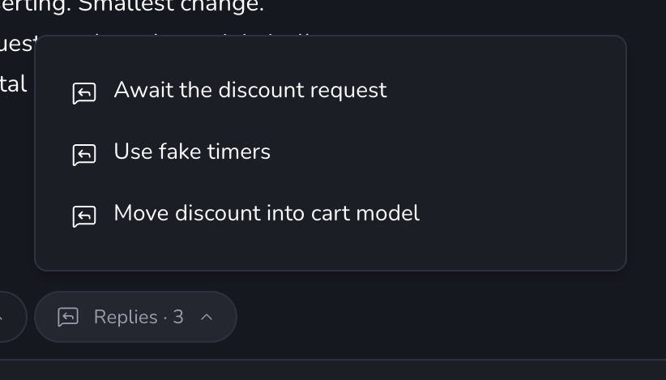

# paseo-replies

A [Paseo](https://paseo.sh) plugin: after each agent turn, a **Replies** pill offers the replies you would
likely send, written by Claude Haiku, and sends the one you pick. It works in every workspace.
[`OVERVIEW.md`](OVERVIEW.md) describes what it does; this file covers setup.



## Setup

You need:

- Paseo **0.13.2** or newer, with **Settings → Plugins → Enable plugins** on.
- The Claude Code CLI (`claude`) on the daemon machine, logged in. The plugin finds it on `PATH`, in
  `~/.local/bin`, `/opt/homebrew/bin` or `/usr/local/bin`.

Install it from GitHub:

```bash
paseo plugin install git:cleiter/paseo-replies
```

No `npm install` is needed to run it: Paseo supplies the SDK and `zod`, and `node_modules` is only for
typechecking and tests.

## Changing it

Clone the repository and install the plugin from your clone instead:

```bash
git clone https://github.com/cleiter/paseo-replies.git
cd paseo-replies
paseo plugin install "$PWD"
npm ci
npm run typecheck
npm test
paseo plugin reload paseo-replies
```

`paseo plugin logs paseo-replies` shows daemon-side output. Client-side errors go to the app's console.
